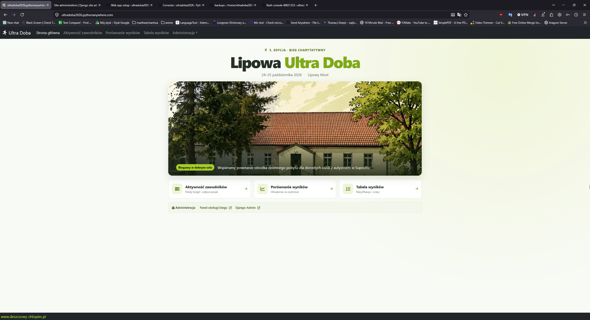
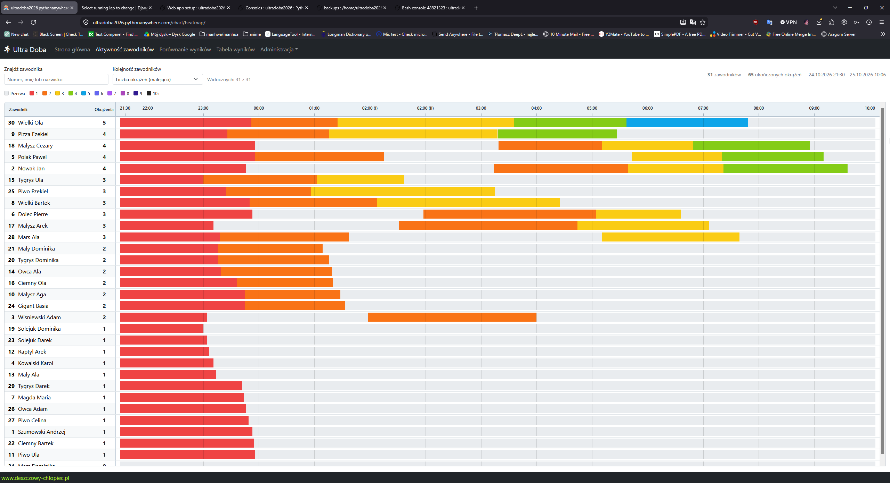
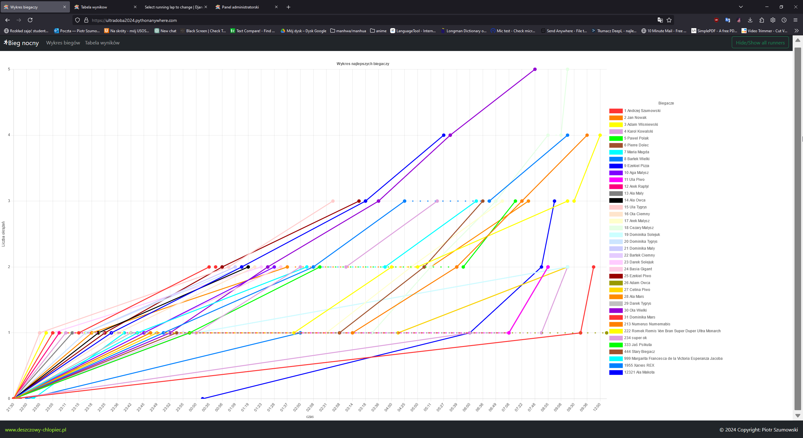
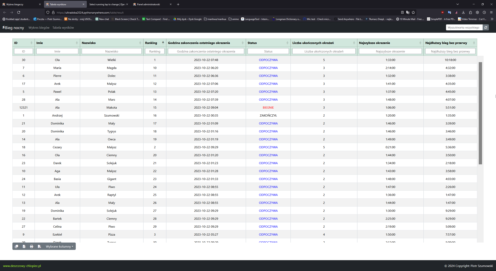
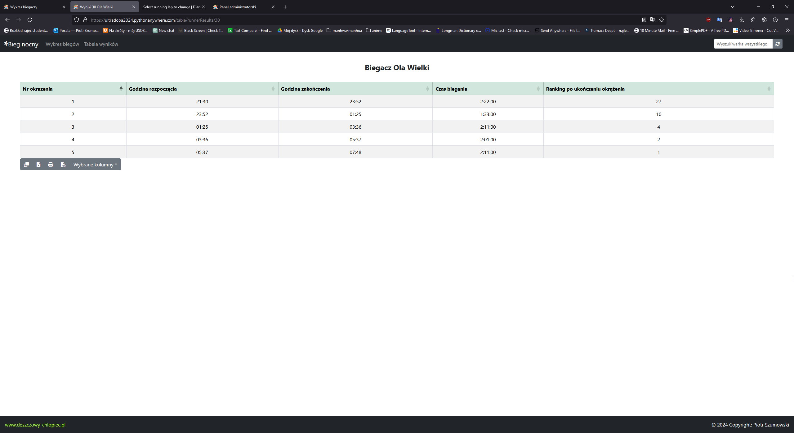
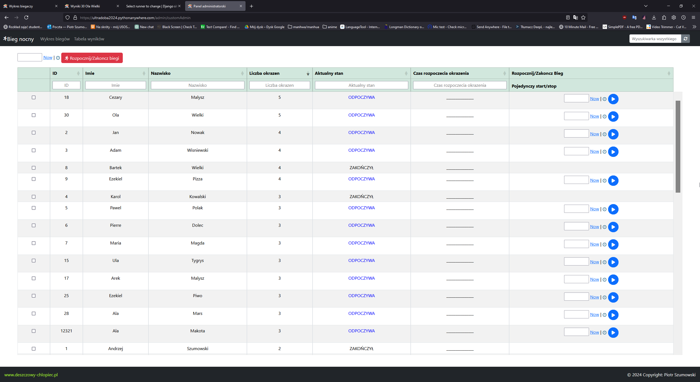
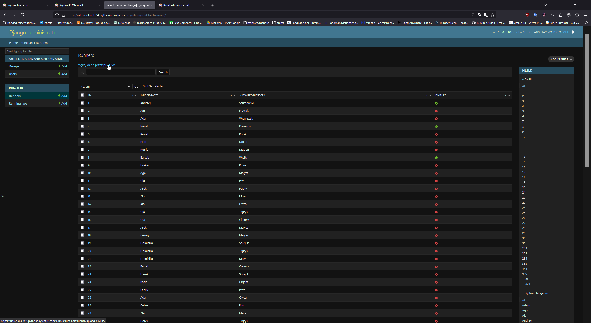

___
**Aplikacja webowa stworzona w Django 4.2.5 i pythonie 3.11.1**
___

## Zawartość README
1. :runner: [Cel aplikacji](#cel-aplikacji)
2. :scroll: [Funkcjonalność](#funkcjonalność)
3. :computer: [Uruchomienie aplikacji lokalnie](#Instrukcja-uruchomienia-aplikacji-lokalnie)
4. :wrench: [Konfiguracja](#konfiguracja)
5. :satellite: [Wdrożenie na serwer pythonanywhere](#wdrożenie-na-serwer-pythonanywhere)
6. :floppy_disk: [Kopia zapasowa bazy SQLite na PythonAnywhere](#kopia-zapasowa-bazy-sqlite-na-pythonanywhere)
7. :globe_with_meridians: [Działanie aplikacji na serwerze](#działanie-aplikacji-na-serwerze)

# Cel aplikacji
Aplikacja została stworzona na potrzeby wydarzenia dwudniowego biegu, zaczynającego się wieczorem i kończącego ranem następnego dnia.<br/>
Aplikacja umożliwia prezentacje wyników biegaczy w formie wykresu i tabeli.<br/>
Zarządzanie danymi biegów aplikacji odbywa się w dostosowanym panelu administracyjnym lub domyślnym panelu administracyjnym.

# Funkcjonalność
1) [x] Strona główna z nawigacją do wyników
2) [x] Wykres liniowy z wynikami biegaczy
3) [x] Wykres aktywności zawodników (heatmapa)
4) [x] Tabela z wynikami biegaczy
5) [x] Tabela z wynikami pojedynczego biegacza
6) [x] Dostosowany panel administracyjny
7) [x] Standardowy panel administracyjny Django


# Instrukcja uruchomienia aplikacji lokalnie:
Tworzymy wirtualne środowisko
```sh
python -m venv venv
```

Aktywujemy wirtualne środowisko
```sh
.\venv\Scripts\activate
```
Instalujemy wszystkie potrzebne biblioteki z pliku `requirements.txt`
```sh
pip install -r .\requirements.txt
```

Uruchomienie projektu Django
```sh
python manage.py runserver 'nrPortu opcjonalnie'
```

# Konfiguracja:

> [!Important]
> ### Ustawiamy datę biegu w:
> [runProject\settings.py](https://github.com/rzymski/runnersChart/blob/master/runProject/settings.py) ${\textsf{\color{gold}FIRST\\_DAY}}$ **`datetime(2024, 11, 2, 21, 30)`**

<details>
  <summary>Kod <b><code>FIRST_DAY</code></b> zawierający datę biegu <b>datetime(2024, 11, 2, 21, 30)</b></summary>

```python
from pathlib import Path

from datetime import datetime, timedelta
FIRST_DAY = datetime(2024, 11, 2, 21, 30)
SECOND_DAY = FIRST_DAY + timedelta(days=1)
```

</details>

> [!Important]
> ### W **`settings.py`** do **`ALLOWED_HOSTS`** dodać adres url, gdzie będzie wystawiona aplikacja:
> np. 'nocnybieg2023.pythonanywhere.com', 'ultradoba2024.pythonanywhere.com', 'ultradoba2025.pythonanywhere.com'.

<h3>Przydatne polecenia:</h3>

Tworzenie migracji po zmianie modelów
```sh
python manage.py makemigrations appName --name changeName
```

Zatwierdzenie migracji
```sh
python manage.py migrate  
```

Tworzenie super użytkownika
```sh
python manage.py createsuperuser
```

Włączenie shell-a w konsoli (pozwala na komunikacje z bazą danych przez ORM)
```sh
python manage.py shell
```

# Wdrożenie na serwer pythonanywhere:
<details>
    <summary><h3>Uruchomienie konsoli w pythonanywhere:</h3></summary>
        W sekcji <code>Consoles</code><br/>
        Uruchamiamy konsole:        
        
</details>

Klonujemy repozytorium:
```sh
git clone https://github.com/rzymski/runnersChart.git
```

Tworzymy wirtaulne środowisko:
```sh
mkvirtualenv --python=/usr/bin/python3.10 venv
```

Pobieramy wszystkie potrzebne pakiety z requirements.txt:
```sh
pip install -r ./runnersChart/requirements.txt
```

<h3><details>
    <summary>Dodanie aplikacji do serwera:</summary>
        Add a new web app --> ... --> Manual Configuration --> Python 3.10 --> ...<br/>
        
</details></h3>

<details>
<summary><h3>Ustawienia w sekcji Web:</h3></summary>
  <br/>Source code: /home/nazwaUzytkownika/runnersChart (nazwa głównego folderu projektu i nazwa repozytorium na github-ie) <br/>
  <br/>Working directory: /home/nazwaUzytkownika <br/>
  <br/>Virtualenv: /home/nazwaUzytkownika/.virtualenvs/venv <br/>
  <br/>Static files: <br/>
  &emsp; URL: /static/ <br/>
  &emsp; DIRECTORY: /home/nazwaUzytkownika/runnersChart/static <br/><br/>
    
WSGI configuration file:
```python
import os
import sys
path = os.path.expanduser('~/runnersChart')
if path not in sys.path:
    sys.path.insert(0, path)
os.environ['DJANGO_SETTINGS_MODULE'] = 'runProject.settings'
from django.core.wsgi import get_wsgi_application
from django.contrib.staticfiles.handlers import StaticFilesHandler
application = StaticFilesHandler(get_wsgi_application())
```

</details>

Po skonfigurowaniu warto również dla pewności jeszcze raz upewnić się, że pliki statyczne są załadowane.<br/>
**Polecenie do przeładowania plików statycznych:**
```sh
python manage.py collectstatic
```

<h3><details>
    <summary>Przeładowanie aplikacji na serwerze:</summary>
        
</details></h3>

W przypadku wyłączenia się konsoli i zamknięcia wirtualnego środowiska, żeby włączyć z powrotem wirtualne środowisko w `/home/ultradoba2024/.virtualenvs`:
```sh
workon venv
```

**Przy pierwszym wdrożeniu wykonanie migracji jest konieczne** (tworzy tabele bazy danych)
```sh
python manage.py migrate
```

# Kopia zapasowa bazy SQLite na PythonAnywhere

1. Na PythonAnywhere otwórz **Consoles → Bash**.
2. Przejdź do katalogu projektu (tam, gdzie jest `manage.py` i `db.sqlite3`):

   ```bash
   cd ~/runnersChart
   ```

3. Utwórz katalog na kopie (wystarczy zrobić to raz):

   ```bash
   mkdir -p backups
   ```

4. Wykonaj kopię poleceniem SQLite:

   ```bash
   sqlite3 db.sqlite3 ".backup 'backups/db-$(date +%Y-%m-%d_%H-%M-%S).sqlite3'"
   ```

5. W panelu PythonAnywhere wejdź w **Files**.
6. Otwórz katalog projektu `runnersChart`, a następnie `backups`.
7. Kliknij opcję **Download** przy wybranym pliku `.sqlite3` i zapisz go na komputerze.

# Działanie aplikacji na serwerze

**Adres aplikacji:** 
 - https://ultradoba2026.pythonanywhere.com/

## Strona główna
- https://ultradoba2026.pythonanywhere.com/


## Aktywność zawodników — wykres kolorowych okrążeń (heatmapa)
- https://ultradoba2026.pythonanywhere.com/chart/heatmap/


## Wykres liniowy — porównanie wyników
- https://ultradoba2026.pythonanywhere.com/chart/line/


## Tabela wyników zawodników
- https://ultradoba2026.pythonanywhere.com/table/result


## Wyniki pojedynczego zawodnika
- https://ultradoba2026.pythonanywhere.com/table/runnerResults/1


## Spersonalizowany panel administracyjny
- https://ultradoba2026.pythonanywhere.com/admin/customAdmin


## Standardowy panel Django Admin
- https://ultradoba2026.pythonanywhere.com/admin/

